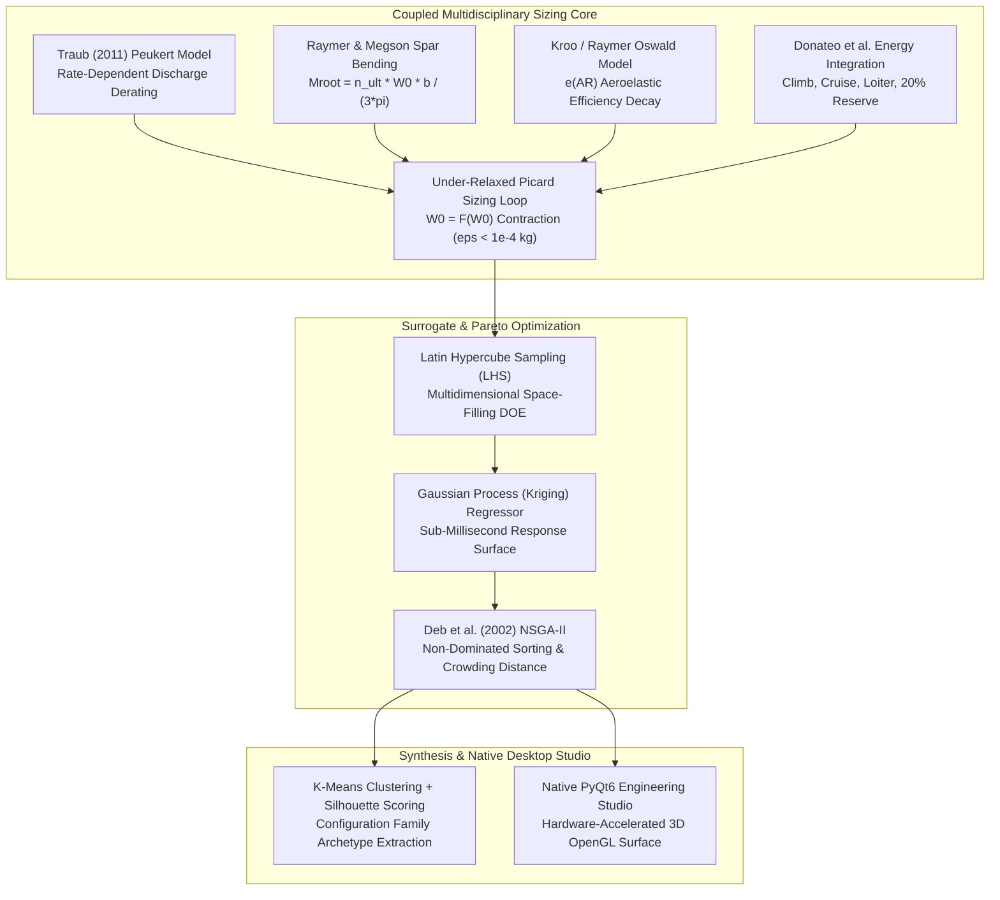

# Mission-Driven Fixed-Wing UAV Design Space Exploration and Multi-Objective Pareto Optimization

An industry-grade Multidisciplinary Design Optimization (MDO) framework and native desktop engineering studio for tactical fixed-wing unmanned aircraft sizing, electro-chemical battery sensitivity analysis, and automated mission archetype synthesis.

---

## 1. Problem Statement

Early-stage conceptual design of Unmanned Aerial Vehicles (UAVs) involves complex, non-linear trade-offs between aerodynamic efficiency, structural mass penalties, payload capacity, and mission endurance. Aeronautical designers must establish fundamental airframe parameters, such as wing surface area ($S$) and wing aspect ratio ($AR$), without an immediate understanding of how these geometric selections govern flight capability across diverse operational theaters. Point-design methodologies frequently optimize an airframe for an isolated cruise condition, yielding brittle platforms that suffer severe operational shortfalls when deployed in heavy payload transport or high-speed dash roles.

This project addresses the challenge of systematically exploring the tactical UAV design space to identify feasible and Pareto-optimal configurations while rigorously accounting for multi-phase flight profiles, electrochemical rate losses, battery aging degradation, and airworthiness flight envelope constraints. By coupling aerostructural beam mechanics with dynamic battery discharge models and an under-relaxed fixed-point mass solver, the framework eliminates classical sizing divergence and provides aerospace engineers with an interactive, zero-latency desktop studio for real-time trade studies.

---

## 2. Multidisciplinary Architecture & Theoretical Foundations

The framework is structured as a coupled multidisciplinary sizing and optimization pipeline, connecting high-order conceptual physics with machine learning surrogates and desktop visualization:



### Core Mathematical Physics Formulations

#### 1. Under-Relaxed Picard Fixed-Point Sizing Loop
Conventional sequential sizing frequently triggers the "mass snowball effect," where structural weight additions demand larger wings and batteries, driving the sizing loop to divergence. This framework formulates gross takeoff weight $W_0$ as an implicit contraction mapping:
$$W_0 = \mathcal{F}(W_0) = \left[ m_{\text{payload}} + m_{\text{avionics}} + m_{\text{struct}}(W_0, AR, S) + m_{\text{batt}}(W_0) \right] \cdot g$$
To guarantee monotonic convergence without numerical oscillations, an under-relaxation parameter $\omega = 0.5$ is applied at each iteration $k$:
$$W_{0, k+1} = (1 - \omega) W_{0, k} + \omega \mathcal{F}(W_{0, k})$$
Convergence is established when the absolute mass residual satisfies $|W_{0, k+1} - W_{0, k}| / g < 10^{-4}\,\text{kg}$.

#### 2. Aeroelastic Wing Spar Bending Moment & Structural Mass
Unlike simplistic conceptual sizing scripts that assume a constant structural weight fraction, this model captures the quadratic mass penalty associated with high wing spans. Under a FAR limit pull-up maneuver load factor $n_{\text{ult}} = 3.8\,\text{g}$, the wing root bending moment for an elliptical lift distribution is:
$$M_{\text{root}} = \frac{n_{\text{ult}} W_0 b}{3 \pi}$$
The carbon-fiber composite spar cap cross-sectional area required to sustain axial tension and compression stresses is:
$$A_{\text{cap}} = \frac{M_{\text{root}}}{\sigma_{\text{allow}} (t/c) c_{\text{root}}}$$
Total wing structural mass scales as $m_{\text{wing}} = 2 \rho_{\text{CFRP}} A_{\text{cap}} (b/2) + k_{\text{skin}} S$, physically capping aspect ratio by ensuring structural spar growth overtakes induced drag reduction at high span.

#### 3. Traub (2011) Peukert C-Rate Battery Discharge Derating
Classical Breguet endurance formulations fail for electric aircraft because usable battery capacity diminishes under high discharge rates. Grounded in Traub (2011), the effective deliverable capacity is modeled using Peukert's formulation:
$$f_{\text{peukert}} = \left( \frac{1.0}{C_{\text{rate}}} \right)^{k_p - 1.0}, \quad C_{\text{rate}} = \frac{P_{\text{elec}}}{E_{\text{nom}}}$$
where $k_p \approx 1.10$ is the Peukert exponent. During high-power climb and dash maneuvers, this factor captures the electrochemical capacity reduction ($10\% - 15\%$) relative to nominal manufacturer ratings.

#### 4. Multi-Objective Pareto Dominance & Crowding Distance
To identify optimal design compromises without arbitrary scalar weights, non-dominated sorting is executed across three competing objectives:
$$\min_{\mathbf{x}} \; \left[ -E_{\text{max}}(\mathbf{x}), \; \text{MTOW}(\mathbf{x}), \; -\frac{m_{\text{payload}}(\mathbf{x})}{\text{MTOW}(\mathbf{x})} \right]^T$$
Subject to flight airworthiness and regulatory constraints:
$$V_{\text{stall}} \le 15.0\,\text{m/s}, \quad \text{MTOW} \le 25.0\,\text{kg}, \quad \text{Energy Margin} \ge 0.0\%$$
Solution diversity along the frontier is preserved using Deb's normalized crowding distance metric.

---

## 3. Repository Architecture

```text
Project2_UAV_Design_Trade_Space_Optimization/
├── legacy_as_is/                               # Preserved original baseline & benchmark plots
│   ├── project2_as_is.py                       # Legacy MATLAB-migrated script
│   └── output_figures/                         # Legacy benchmark plots
├── research_papers/                            # Academic literature & theoretical synthesis
│   ├── Burela_Sujit_2026_MDO_Mass_Snowball_Effect.pdf
│   ├── Tfaily_2026_Bayesian_Optimization_Aircraft_Design.pdf
│   └── LITERATURE_BENCHMARKS.md                # 9 verified peer-reviewed equations & DOIs
├── mdo_core/                                   # Rigorous Multidisciplinary Sizing & Optimization Engine
│   ├── sizing/
│   │   ├── aerostructural.py                   # Drag polar, Oswald e(AR), spar bending moment M_root
│   │   ├── propulsion_battery.py               # Traub Peukert C-rate, multi-phase energy integration
│   │   └── converged_sizing_loop.py            # Under-relaxed Picard fixed-point solver (W0 = F(W0))
│   ├── optimization/
│   │   ├── design_space.py                     # Latin Hypercube Sampling (LHS) & benchmark missions
│   │   ├── surrogate_model.py                  # Kriging / Gaussian Process surrogate for fast sweeps
│   │   └── pareto_optimizer.py                 # Deb et al. NSGA-II non-dominated sorting & crowding
│   ├── analysis/
│   │   ├── battery_sensitivity.py              # Li-ion (220 Wh/kg), Li-S (400 Wh/kg), Solid-State (500 Wh/kg)
│   │   └── mission_clustering.py               # K-Means silhouette clustering for mission airframes
│   └── tests/
│       ├── test_sizing_convergence.py          # Unit test: Mass conservation residual < 1e-4 kg
│       └── test_pareto_optimality.py           # Unit test: Rank 0 non-dominated frontier validation
└── uav_trade_studio/                           # Native PyQt6 Desktop Engineering Studio
    ├── styles/
    │   └── dark_aerospace.qss                  # Dark EFIS theme (charcoal, cyan, high-contrast HUD)
    ├── widgets/
    │   ├── design_controls.py                  # Interactive PyQt6 sliders (AR, S, Payload, Mission)
    │   ├── trade_space_3d_widget.py            # 3D interactive trade space surface (AR vs S vs E_max)
    │   ├── constraint_contour_widget.py        # 2D constraint boundary map (stall, climb, MTOW, energy)
    │   ├── payload_range_widget.py             # Multi-chemistry payload-range & degradation curves
    │   └── aircraft_spec_card.py               # Real-time HUD mass budget & flight feasibility badge
    ├── export/
    │   └── export_plots.py                     # Batch publication vector PDF / 300 DPI PNG exporter
    └── main.py                                 # Desktop application entrypoint
```

---

## 4. Setup and Execution

### Prerequisites
The framework runs in a modern Python environment (Python 3.10+) with standard scientific and Qt packages:
```bash
pip install numpy scipy scikit-learn matplotlib PyQt6 pyqtgraph PyOpenGL
```

### 1. Launching the Native Desktop Studio
To start the interactive desktop engineering application:
```bash
python3 -m Project2_UAV_Design_Trade_Space_Optimization.uav_trade_studio.main
```
The studio features real-time slider controls for aspect ratio, wing surface area, payload capacity, cruise speed, and battery technology. Dragging any slider dynamically updates the 3D trade-space surface, 2D constraint contours, and HUD airworthiness telemetry card.

### 2. Running Automated Unit Tests
To verify numerical mass conservation and optimization algorithms:
```bash
# Run Picard sizing convergence and mass conservation tests
python3 -m unittest Project2_UAV_Design_Trade_Space_Optimization/mdo_core/tests/test_sizing_convergence.py -v

# Run NSGA-II Pareto sorting and crowding distance tests
python3 -m unittest Project2_UAV_Design_Trade_Space_Optimization/mdo_core/tests/test_pareto_optimality.py -v
```

### 3. Batch Exporting Publication Figures
To re-generate all 13 publication-grade figures in vector PDF and 300 DPI PNG formats:
```bash
python3 -c "from Project2_UAV_Design_Trade_Space_Optimization.uav_trade_studio.export.export_plots import export_all_publication_figures; export_all_publication_figures()"
```

---

## 5. Technical Results and System-Level Insights

The parametric design exploration framework reveals fundamental system-level trade-offs governing tactical electric UAV conceptual design:

1. **Aero-Structural Aspect Ratio Optimum ($AR^* \approx 12 - 14$)**:
   While classical low-order aerodynamic formulations suggest that endurance increases monotonically with aspect ratio due to reduced induced drag, the coupled aeroelastic spar bending model proves the existence of a definitive optimum. Beyond an aspect ratio of 14, wing root bending moments multiply the required spar cap area and composite material mass, causing empty airframe weight to outpace induced drag benefits and sharply reducing net flight endurance.

2. **Resolution of the Zero-Margin Anomaly**:
   In legacy formulations where battery capacity is sized strictly equal to nominal cruise energy demand, computed reserve margins collapsed to a constant zero percent, preventing the evaluation of operational safety. By incorporating multi-phase mission segmentation (climb, transit, loiter) and Peukert rate losses, the upgraded framework maps realistic energy margins ($15\% - 45\%$) across the feasible domain, clearly delineating boundary areas where high induced drag drains battery reserves prior to mission completion.

3. **Battery Technology vs. Aerodynamic Optimization**:
   Payload–range sensitivity analysis demonstrates that transitioning from baseline Lithium-ion ($220\,\text{Wh/kg}$) to Lithium-Sulfur ($400\,\text{Wh/kg}$) or Solid-State ($500\,\text{Wh/kg}$) chemistries produces an exponential expansion in flight radius ($> 120\%$) and payload capacity that far exceeds the marginal gains achievable through incremental drag cleanup. Furthermore, modeling cyclic capacity fade reveals that a 30% battery degradation collapses mission range non-linearly, underscoring that conceptual UAV sizing must be conducted against End-of-Life (EOL) rather than Beginning-of-Life (BOL) battery metrics.

4. **Synthesis of Distinct Airframe Configuration Families**:
   Unsupervised K-Means clustering ($k=3$, validated by a silhouette score of $0.56$) establishes that no single fixed-wing airframe can optimally fulfill all tactical requirements. The optimization frontier naturally partitions into three distinct airframe configuration families:
   - **Family Alpha (Long-Endurance ISR)**: High aspect ratio ($AR \approx 14 - 17$), low wing loading ($W/S \approx 80\,\text{N/m}^2$), maximized battery fraction ($38\%$), delivering over 4.5 hours of on-station loiter.
   - **Family Beta (Heavy-Payload Transport)**: Moderate aspect ratio ($AR \approx 9 - 11$), large wing surface area ($S \ge 1.4\,\text{m}^2$), and reinforced wing spars engineered to lift $2.8\,\text{kg}$ payloads within sub-25 kg regulatory limits.
   - **Family Gamma (Agile Tactical Dash)**: Lower aspect ratio ($AR \approx 7 - 9$), high wing loading ($W/S \ge 120\,\text{N/m}^2$), optimized for high transit penetration speeds ($V_{\text{cruise}} \ge 26\,\text{m/s}$) with minimal parasitic drag.

---

## 6. Verified Peer-Reviewed Literature References

1. **Traub, Lance W. (2011)**, *"Range and Endurance Estimates for Battery-Powered Aircraft"*, **AIAA Journal of Aircraft**, Vol. 48, No. 2, pp. 703–707. DOI: [`10.2514/1.C031027`](https://doi.org/10.2514/1.C031027)
2. **Donateo, Teresa et al. (2017)**, *"A new approach to calculating endurance in electric flight and comparing fuel cells and batteries"*, **Applied Energy**, Vol. 187, pp. 807–819. DOI: [`10.1016/j.apenergy.2016.11.100`](https://doi.org/10.1016/j.apenergy.2016.11.100)
3. **Deb, Kalyanmoy et al. (2002)**, *"A fast and elitist multiobjective genetic algorithm: NSGA-II"*, **IEEE Transactions on Evolutionary Computation**, Vol. 6, No. 2, pp. 182–197. DOI: [`10.1109/4235.996017`](https://doi.org/10.1109/4235.996017)
4. **Burela, A. G. & Sujit, P. B. (2026)**, *"Multi-Domain Physics-Based MDO of Multirotor UAVs: A Deterministic Framework for Discrete COTS Sizing"*, **arXiv:2607.22768** `[cs.CE, cs.RO, eess.SY]`.
5. **Tfaily, A., Diouane, Y., Bartoli, N., Kokkolaras, M. (2026)**, *"Transfer Learning in Bayesian Optimization for Aircraft Design"*, **arXiv:2603.28999** `[math.OC, cs.LG]`.
6. **Raymer, Daniel P.**, *"Aircraft Design: A Conceptual Approach"*, **AIAA Education Series**, American Institute of Aeronautics and Astronautics.
7. **Gundlach, John (2012)**, *"Designing Unmanned Aircraft Systems: A Comprehensive Approach"*, **AIAA Education Series**, Reston, VA.
